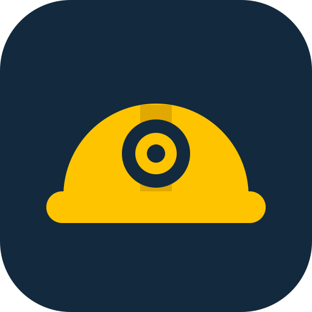
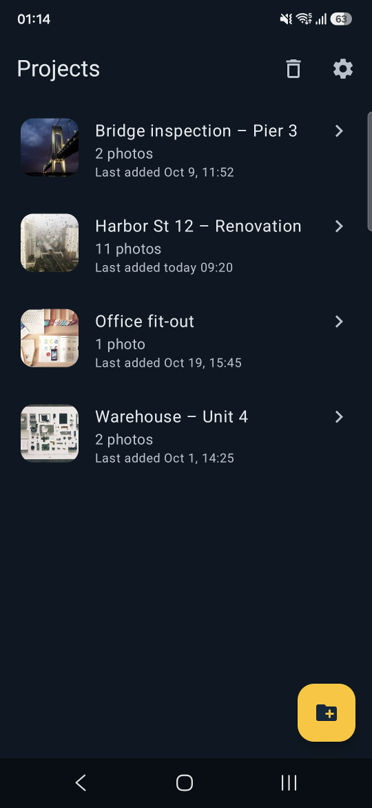
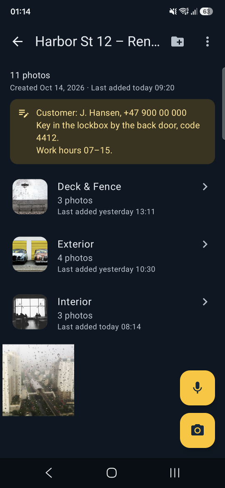
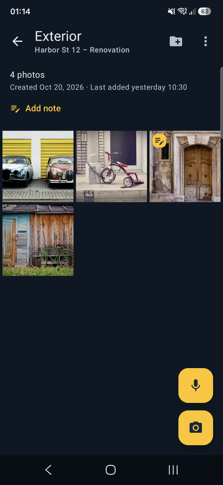
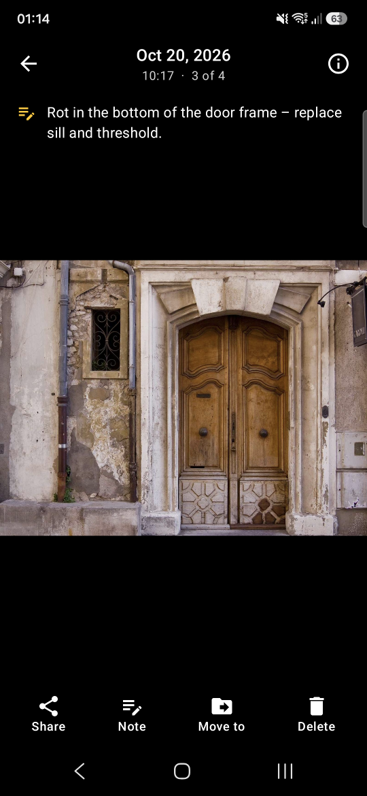
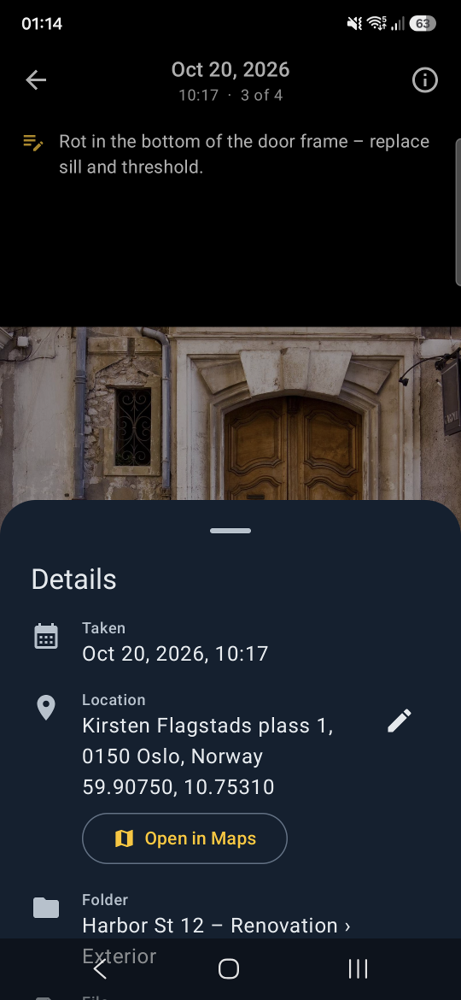
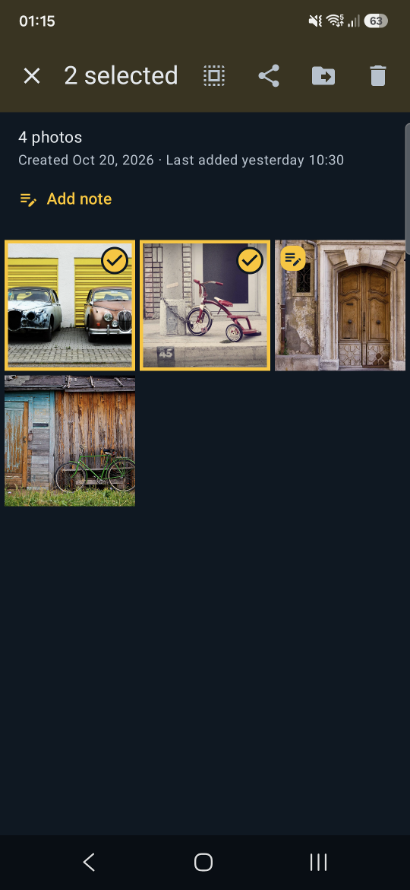
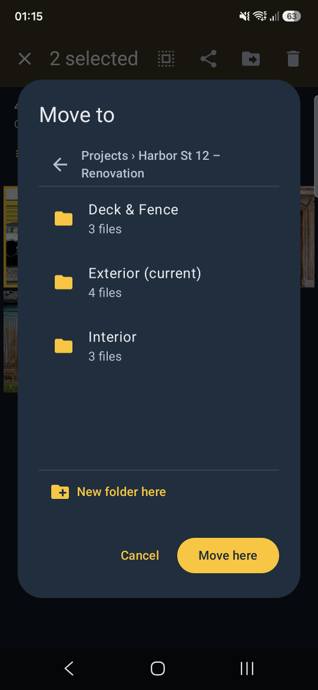
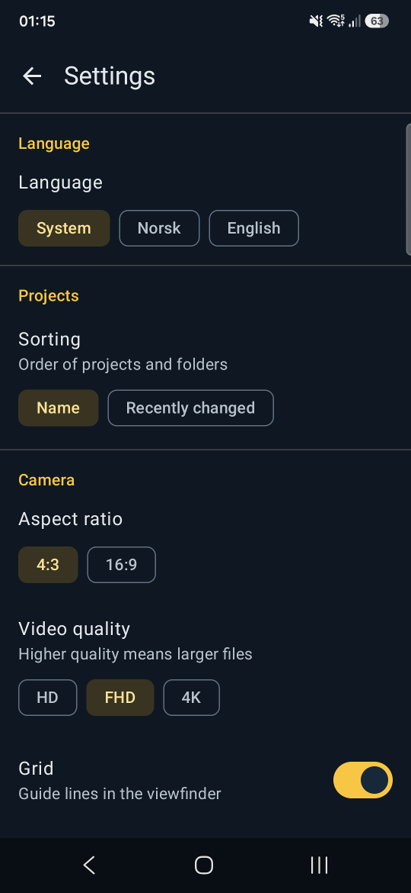

<p align="center">
  
</p>

<h1 align="center">Onsite</h1>

<p align="center">
  <b>The job-site camera with a filing system.</b><br>
  Capture photos, video and voice notes straight into project folders – organised, annotated and kept out of your personal camera roll.
</p>

<p align="center">
  
  
  
  
  
  <a href="LICENSE"></a>
</p>

---

## Screenshots

<table>
  <tr>
    <td align="center"><br><sub><b>Projects</b><br>cover, counts, last activity</sub></td>
    <td align="center"><br><sub><b>Project</b><br>folder note &amp; subfolders</sub></td>
    <td align="center"><br><sub><b>Folder</b><br>photos with note badges</sub></td>
    <td align="center"><br><sub><b>Viewer</b><br>note, share, move, delete</sub></td>
  </tr>
  <tr>
    <td align="center"><br><sub><b>Details</b><br>time, GPS address, Open in Maps</sub></td>
    <td align="center"><br><sub><b>Multi-select</b><br>share, move or delete in bulk</sub></td>
    <td align="center"><br><sub><b>Move to</b><br>browse-style folder picker</sub></td>
    <td align="center"><br><sub><b>Settings</b><br>language, camera, storage</sub></td>
  </tr>
</table>

<sub>Demo photos from <a href="https://unsplash.com">Unsplash</a> (via Lorem Picsum) by Paul Evans, Dietmar Becker,
Florian Klauer, Alexander Shustov, Steve Richey, Rodrigo Melo, Thanun Buranapong, Johnny Lam, Vadim Sherbakov,
Aleks Dorohovich, Adam Przewoski, Luke Chesser, Art Wave, Christian Bardenhorst and Charlie Foster.</sub>

## Why Onsite?

Field work produces hundreds of photos across many jobs. In a regular camera app they end up mixed with
personal pictures and are painful to sort, share and hand over. Onsite gives every job its own folder from
the moment you press the shutter – so documentation is organised before you even leave the site.

## Features

**Projects & folders**
- Projects with unlimited nested subfolders (e.g. *Job 123 › Bathroom › Before*)
- Folder overview with cover photo, counts per media type, created date and last activity
- Notes on folders – address, contact person, agreements
- Multi-select files *and* folders to share, move or delete
- Browse-style folder picker with "new folder here"
- Trash with 30-day restore

**Capture**
- Photo and video modes with audio, front/back camera
- Zoom presets (incl. ultra-wide where available) and pinch-to-zoom
- Flash / torch, exposure compensation, tap-to-focus, rule-of-thirds grid
- 4:3 or 16:9, video in HD / Full HD / 4K
- Hardware volume keys as shutter – works with gloves
- Voice notes recorded straight into the current folder (pause/resume, level meter)

**Review & document**
- Gallery-style viewer with swipe, pinch-zoom and video/audio playback
- Notes on every photo, video and voice note (dictate with the keyboard mic)
- Details panel: capture time, GPS address with *Open in Maps*, resolution, duration, camera
- Correct a wrong GPS address manually
- Optional stamp burned into photos (date, address, project path)

**Fits into your workflow**
- *Share → Onsite* from the system camera, gallery or any app to file existing media into a project
- Share files or whole folders to e-mail, Teams, Slack, etc.
- English and Norwegian (follows the system language, or pick one in settings)
- Navy & safety-yellow theme in light and dark mode

## Storage design

Everything is stored as plain files under **`Pictures/Onsite/`** on the device:

```
Pictures/Onsite/
├── Job 123/
│   ├── .notat.txt                  ← folder note
│   ├── Bathroom/
│   │   ├── IMG_20261021_101500.jpg
│   │   ├── .IMG_20261021_101500.jpg.notat.txt    ← photo note
│   │   └── VID_20261021_101622.mp4
│   └── LYD_20261021_102010.m4a     ← voice note
└── .papirkurv/                     ← trash (30 days)
```

- No database: the folder tree **is** the data model, so it can be mirrored 1:1 to cloud storage.
- Notes and corrected addresses are hidden sidecar files that travel with their media.
- Files survive uninstalling the app; a `.nomedia` marker keeps them out of the system gallery (toggle in settings).
- GPS is written to photo EXIF and video metadata.

## Roadmap

- [ ] Cloud sync of a shared project root (OneDrive/SharePoint or Google Drive) for teams
- [ ] Draw / mark up on photos
- [ ] PDF report export with photos, notes, dates and locations
- [ ] Search across projects
- [ ] Project status (active / done / archived)

## Install

Download the latest **`Onsite-<version>.apk`** from [Releases](../../releases), open it on your phone and allow
installing from unknown sources. On first launch Onsite asks for **All files access** so it can manage
`Pictures/Onsite`.

Requires Android 8.0+ (per-app language selection needs Android 13+).

## Build

```bash
./gradlew assembleDebug      # debug build
./gradlew assembleRelease    # signed release build
```

Requires JDK 17+ and the Android SDK (compileSdk 35).

Release builds are signed with a key kept **outside** the repository. Point `ONSITE_SIGNING` at a properties
file (default `~/.android-keys/onsite-release.properties`) containing `storeFile`, `storePassword`,
`keyAlias` and `keyPassword`. Without it the release APK is left unsigned. Keep the key safe – updates must
be signed with the same key.

## Tech stack

Kotlin · Jetpack Compose (Material 3) · CameraX 1.4 (photo + video) · Media3 ExoPlayer · Coil ·
AndroidX ExifInterface · MediaRecorder · Android per-app locales · 16 KB page-size compatible

## License

[MIT](LICENSE) © 2026 Espen Mjøs. Demo photos in `docs/screenshots` are from Unsplash under the
[Unsplash License](https://unsplash.com/license).
